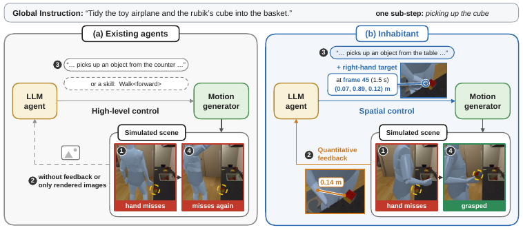

# Inhabitant

<!-- authors -->
**Inhabitant: An Agent Framework for Long-Horizon Human-Scene Interaction with Spatial Control and Quantitative Feedback**

Yao Zhang\*, Zhuchenyang Liu\*, Yu Xiao &nbsp;(\* equal contribution) &nbsp;·&nbsp; Aalto University

[Project page](https://ryenhails.github.io/Inhabitant/) &nbsp;|&nbsp; arXiv (coming soon) &nbsp;|&nbsp; Benchmark on Hugging Face (coming soon)
<!-- /authors -->

Inhabitant is a training-free LLM agent that carries out household tasks with a human body. It drives the pretrained motion
generator [Kimodo](https://github.com/nv-tlabs/kimodo) one segment at a time with Kimodo's own inputs (text and its constraint
JSON); every try is executed in a half-physics simulator ([HumanCLAW](https://github.com/Human-CLAW/HumanCLAW)'s habitat-sim
build: furniture blocks the body, objects move physically), the agent measures the result with a read-only `inspect` tool,
revises, and commits. This repository holds the agent, and **Inhabit**, a benchmark of 75 household tasks with its evaluation.

<!-- teaser -->
<p align="center"></p>
<!-- /teaser -->

## How it works

One episode is one conversation. The model gets a fixed system prompt (how to move with Kimodo, the tools, the rules of the
world, the body's size, and Kimodo's documentation), the task instruction and the full state of the apartment. It then acts
through five tools:

| tool | what it does |
|---|---|
| `generate_segment(intent, text, seconds, constraints, seed, post, cfg_weight, events)` | Kimodo makes one segment (0.5-8 s) that continues from the body's actual pose; it is fitted to the simulated body and executed from the last committed state, with `events` (grasp / release). Returns whether the goal is now satisfied and eight frames of the video. Nothing is kept yet. |
| `inspect(queries)` | read-only measurements: where things and body parts are (now or over a try), distances over time, body contacts, sizes, an executed pose in Kimodo's format, forward kinematics of a planned pose |
| `commit()` | keeps the last try; the world continues from where it ended |
| `get_state()` | the full state |
| `retry_from(i)` | undo: back to the start of committed segment `i` |

The episode ends when a committed segment completes the task, when the model stops calling tools, or when the budget of calls
(150) is used up. The goal conditions are hidden; the model only learns after each try whether the goal is satisfied.
`python -m inhabitant.agent --print_prompt` prints the system prompt and the tool definitions.

## Install

Tested on Linux with an NVIDIA GPU (CUDA 12.4), Python 3.11. A run needs a GPU: Kimodo takes about 19 GB of GPU memory with
its text encoder on the GPU (set `TEXT_ENCODER_DEVICE=cpu` on smaller cards), and every simulator needs a GL context.

> The four scripts below were written for this release from the steps that built our own environment. They have not been
> run end to end on a fresh machine; treat them as a precise description of the steps and expect to adapt them (compilers,
> CUDA, proxies). Places we could not verify are marked "not verified" below.

```bash
git clone https://github.com/yaozhang182/inhabitant.git inhabitant && cd inhabitant
bash scripts/install_env.sh            # 1. conda env "inhabitant": Python 3.11, torch 2.6.0 (cu124), this package
conda activate inhabitant
bash scripts/install_habitat.sh        # 2. HumanCLAW, habitat-sim (half-physics build), habitat-lab 0.3.0 + patches
bash scripts/install_eb_habitat.sh     # 3. EmbodiedBench, EB-Habitat assets, start poses (GPU)
bash scripts/install_kimodo.sh         # 4. Kimodo's code and its extra packages; then get the weights (below)
cp configs/models.example.json configs/models.json
```

What the steps do:

1. **Environment.** Python 3.11, `torch==2.6.0` (cu124), GL / EGL runtime libraries and `libstdcxx-ng>=13` from conda-forge
   (a habitat-sim built with gcc 13 needs GLIBCXX_3.4.32), the Python packages, and `pip install -e .`.
2. **Simulator.** [HumanCLAW](https://github.com/Human-CLAW/HumanCLAW) provides the half-physics controller, the body (URDF)
   and a patch for habitat-sim. The script clones it to `third_party/HumanCLAW`, builds habitat-sim at the revision HumanCLAW
   pins (`acbe6f4`, version 0.3.3) with `patches/habitat-sim/humanclaw_halfphysics.patch` (headless, CUDA, Bullet), exactly as
   HumanCLAW's README says, and installs habitat-lab **0.3.0** (`--no-deps`) with two patches from `patches/`:
   - `patch_py311_dataclass.py`: Python 3.11 rejects `x: FooConfig = FooConfig()` dataclass defaults in habitat-lab;
   - `habitat_lab_0.3.0_rearrange_sim_reset.patch`: habitat-sim 0.3.3 `Simulator.reset()` puts objects back to their
     creation state, which sent every episode object to the origin; `RearrangeSim.reset` saves and restores the transforms.
     (Only EB-Habitat's own environment needs this, i.e. step 3's export of the start poses.)

   Not verified: we used a habitat-sim build shared on our machine (the same revision and patch), not a fresh build by this
   script; the paths `resources/agent/neutral_beta0_handmerged/` and `src/humanclaw_bench/envs/half_physics_env.py` are those
   of HumanCLAW at commit `13a8b6d`.
3. **Scenes.** The tasks are built on [EmbodiedBench](https://github.com/EmbodiedBench/EmbodiedBench)'s EB-Habitat episodes
   (tested at commit `9be4e98`). The script clones it (the episode files are in git-lfs), downloads the assets with
   `python -m habitat_sim.utils.datasets_download --uids rearrange_task_assets` into `data/eb_habitat/data`, and runs
   `scripts/export_eb_meta.py` for the six subsets, which writes `data/eb_meta/<subset>/<id>.json`. Inhabitant reads from
   EmbodiedBench: `embodiedbench/envs/eb_habitat/datasets/<subset>.pickle` and `dataset/configs/{dataset,instructions}.yaml`;
   from the export only the start pose of each episode (the person starts where EB's robot starts). EB's own environment is
   not used at run time.
4. **Kimodo.** The script clones [Kimodo](https://github.com/nv-tlabs/kimodo) (unmodified, tested at commit `e1c219c`) to
   `third_party/kimodo` and installs `peft`, `accelerate`, `psutil` and Kimodo's `MotionCorrection` extension into
   `third_party/kimodo_extra` (`pip --no-deps --target`, so the main environment is not changed). Not verified: the versions
   we ran were peft 0.21, accelerate 1.15 and transformers 5.20; the script does not pin them.

   **Kimodo weights** (not downloaded by the script; both are gated on Hugging Face and need an accepted licence):
   - the checkpoint `Kimodo-SMPLX-RP-v1` (NVIDIA R&D model licence, research use only) in `data/kimodo/Kimodo-SMPLX-RP-v1/`
     (`config.yaml`, `model.safetensors`, `stats/`);
   - its text encoder in the Hugging Face cache `data/kimodo/hf_hub/`: `meta-llama/Meta-Llama-3-8B-Instruct` and
     `McGill-NLP/LLM2Vec-Meta-Llama-3-8B-Instruct-mntp` (and `-mntp-supervised`), e.g. with
     `HF_HUB_CACHE=data/kimodo/hf_hub huggingface-cli download <repo>`. The generator runs offline (`HF_HUB_OFFLINE=1`).

Locations can be moved with environment variables (`inhabitant/paths.py`):

| variable | default | what |
|---|---|---|
| `INHABITANT_DATA` | `data/` | `eb_habitat/data`, `eb_meta/`, `kimodo/` |
| `INHABITANT_RUNS` | `runs/` | where runs are written |
| `HUMANCLAW_ROOT` | `third_party/HumanCLAW` | HumanCLAW clone |
| `EMBODIEDBENCH_ROOT` | `third_party/EmbodiedBench` | EmbodiedBench clone |
| `KIMODO_ROOT`, `KIMODO_EXTRA`, `KIMODO_WEIGHTS` | `third_party/kimodo`, `third_party/kimodo_extra`, `$INHABITANT_DATA/kimodo` | Kimodo's code, its extra packages, its weights |
| `INHABITANT_MODELS` | `configs/models.json` | model configuration |
| `GEN_RPC_SHARED` | - | directory of a shared generator service (below) |

### Models

`configs/models.example.json` lists the five models of the paper: Claude Opus 5.5, Claude Sonnet 5.5, Gemini 4 Argon,
gpt-6-luna and GLM-5.3-Flash (open weights, through any OpenAI-compatible server such as vLLM; set its `base_url`). Keys are
read from `ANTHROPIC_API_KEY`, `OPENAI_API_KEY`, `GEMINI_API_KEY`, or from a file named by `key_file` in the model's entry.
Other models: add an entry with one of the providers `anthropic`, `openai_responses`, `openai_chat`, `gemini`; the model must
accept tool calls and images. Responses are cached in `cache/llm/` and every call is logged in `logs/llm_calls.jsonl`
(`python -m inhabitant.llm --spend` sums tokens and cost).

## Quick start

### One task with the built-in loop

```bash
export ANTHROPIC_API_KEY=...
python -m inhabitant.agent --task low_01 --model claude-opus-5.5 --tag main     # or: scripts/run_episode.sh low_01
```

The run directory `runs/claude-opus-5.5/main/inhabit_low_01/` gets `log.json` (conversation, every try, the committed
program, success), `tries/t<n>.mp4` (left: a camera following the body, right: a side camera), `t<n>_sheet.jpg` (the eight
frames the model sees), `t<n>_joints.npz` and `t<n>_world.npz` (the executed motion and the objects per frame). The first
`generate_segment` starts the generator (Kimodo loads in under a minute); a try takes roughly 10-15 s of simulation.

Your own task: write a task file (format in [`benchmark/inhabit/README.md`](benchmark/inhabit/README.md)) and pass
`--spec my_task.json`.

### One task with an MCP client as the agent

`inhabitant/mcp_server.py` serves the same five tools over the Model Context Protocol (stdio), so any MCP client (Claude
Code, Claude Desktop, your own agent) can be the agent. One server process is one episode:

```bash
python -m inhabitant.mcp_server --task low_01 --out runs/mcp/low_01 [--max_calls 150]
```

- Tools: `generate_segment`, `inspect`, `commit`, `get_state`, `retry_from`, with the same descriptions, argument schemas and
  result texts as in the built-in loop; a try returns its text and the eight frames as an image.
- Prompt `inhabitant_task`: the system prompt of the built-in agent, the task instruction and the initial state. The agent
  must read it first (it is also written to `<out>/brief.md`).
- The episode ends when a committed segment completes the task or after `--max_calls` tool calls; later calls answer "The
  episode is over". `log.json` is written after every call, in the format of the built-in loop.

Register it in Claude Code (run from the repository, in the conda environment, so that `python` is the environment's):

```bash
claude mcp add inhabitant -- python -m inhabitant.mcp_server --task low_01 --out runs/mcp/low_01
```

or in a JSON configuration (`.mcp.json` of Claude Code, `claude_desktop_config.json`, or your client's equivalent):

```json
{
  "mcpServers": {
    "inhabitant": {
      "command": "/path/to/envs/inhabitant/bin/python",
      "args": ["-m", "inhabitant.mcp_server", "--task", "low_01", "--out", "/path/to/inhabitant/runs/mcp/low_01"],
      "env": {"INHABITANT_DATA": "/path/to/inhabitant/data"}
    }
  }
}
```

Then start the agent with the prompt (in Claude Code: `/mcp__inhabitant__inhabitant_task`) and let it work until the task is
accomplished. Notes: building the world takes about a minute after the server starts (the tool list answers at once, the
prompt and the first tool call wait for it); a `generate_segment` call can take a minute or more, so raise the client's tool
timeout if it has one (Claude Code: the environment variables `MCP_TIMEOUT` and `MCP_TOOL_TIMEOUT`, in ms; not verified for
other clients). The simulator's output goes to the server's stderr. For a faithful comparison with the built-in loop, give the
agent only these tools.

**Example client.** `examples/mcp_client.py` shows the whole client side in one short file, with the standard `mcp` client
SDK: it starts the server as a stdio subprocess, reads the tool list and the prompt `inhabitant_task`, converts the MCP tool
schemas to the model's function-calling format, and runs the loop (model call -> `call_tool` -> the text and the image go
back into the conversation) until the server says the episode is over.

```bash
python examples/mcp_client.py --task low_01 --model claude-opus-5.5     # a model of configs/models.json, key from the environment
python examples/mcp_client.py --task low_01 --dry_run                   # a scripted model: checks the install, no API key
```

The server it starts needs the GPU machine with the simulator and Kimodo installed; the model can be any entry of
`configs/models.json`. It is an example, not a requirement: any MCP-capable client or agent framework can drive the server.

## Run the benchmark

```bash
JOBS=3 scripts/run_benchmark.sh claude-opus-5.5 main              # all 75 tasks, 3 episodes at a time on one GPU
scripts/run_benchmark.sh gpt-6-luna main low_01 low_02 mid_07     # some tasks
```

The script starts one shared Kimodo service (`python -m inhabitant.generator --rpc <dir> --shared`, used by the episodes
through `GEN_RPC_SHARED`), runs the episodes and skips those that already have a `log.json`. On several GPUs, run it once
per GPU with different task ids (`CUDA_VISIBLE_DEVICES`).

## Evaluate

```bash
scripts/evaluate.sh runs/claude-opus-5.5/main        # CPU only
```

For every episode this writes `report.md` (every commit and every try), `final.mp4` (the committed segments joined, with
captions), `final_motion.npz` (the executed motion) and `stats.json`; for the set, `summary.md` with tables per episode, per
level and per task category: success, sub-goal completion (share of a task's conditions satisfied), calls, tokens, time,
segments, collisions (body contacts other than feet on the floor, hands on what they grasp, and what the task asks for),
blocked segments (the executed pelvis ends up more than 0.3 m from the generated one), disturbed objects, foot-skate ratio,
missed grasps / releases, and success within k tries.

## The Inhabit benchmark

75 tasks in `benchmark/inhabit/` (`low_01`-`low_30`, `mid_01`-`mid_20`, `high_01`-`high_15`, `body_01`-`body_10`): picking
and placing on shelves, tables and in containers, drawers and the fridge, throwing, kicking and pushing, and tasks where the
body itself is part of the goal (sit, lie, kneel). The task file format and the success conditions are described in
[`benchmark/inhabit/README.md`](benchmark/inhabit/README.md); the rules are in `inhabitant/world/bench_goal.py`.

## Repository layout

```
inhabitant/                 the Python package
  prompt.py                 system prompt, tool definitions, loader of Kimodo's documentation
  episode.py                Episode: the five tools, execution, inspect, state text, cameras, logs
  agent.py                  the LLM loop (budget of calls, end on success) and the command line
  mcp_server.py             the same five tools as an MCP server (stdio)
  llm.py                    LLM client: Anthropic, OpenAI Responses, OpenAI-compatible chat, Gemini; cache and call log
  paths.py                  locations and their environment variables
  world/                    eb_world.py (the scene in the half-physics simulator; grasp / carry / release / handle rules;
                            EB-Habitat's predicates), bench_goal.py (success conditions), agent_io.py (state text, map),
                            hp_bridge.py (HumanCLAW's HalfPhysicsEnv)
  motion/                   motion_exec.py (frames, generated body -> simulated body, placement, executed end -> Kimodo input),
                            ik.py, smpl_fk.py, motion_metrics.py
  generator/                gen_kimodo.py (Kimodo with its native inputs), gen_server.py (the generator service)
  eval/                     episode_report.py, summarize.py
  docs/kimodo_docs.md       Kimodo's documentation as the agent reads it
benchmark/inhabit/          the 75 tasks and their format
scripts/                    run_episode.sh, run_benchmark.sh, run_generator.sh, evaluate.sh, install_*.sh, export_eb_meta.py
patches/                    the two habitat-lab patches
tests/                      replay_log.py (replay the tool calls of a finished run, no LLM), mcp_smoke.py (MCP server
                            with a scripted client, no LLM); both need a GPU
configs/models.example.json
examples/                   mcp_client.py (a model drives the MCP server: the client side in one file)
```

## Licence

The code in this repository is released under the Apache License 2.0 (`LICENSE`). `inhabitant/docs/kimodo_docs.md` is taken
from Kimodo's documentation (Apache-2.0). Third-party code, models and data keep their own licences and are not
redistributed here: Kimodo's code (Apache-2.0) and the Kimodo-SMPLX-RP-v1 checkpoint (NVIDIA R&D model licence, research use
only), the Llama 3 text encoder (Meta Llama 3 Community License), HumanCLAW, habitat-sim and habitat-lab, EmbodiedBench,
and the ReplicaCAD and YCB assets; see their repositories.

## Citation

```bibtex
@article{zhang2026inhabitant,
  title   = {Inhabitant: An Agent Framework for Long-Horizon Human-Scene Interaction with Spatial Control and Quantitative Feedback},
  author  = {Zhang, Yao and Liu, Zhuchenyang and Xiao, Yu},
  journal = {arXiv preprint},
  year    = {2026}
}
```

## Acknowledgements

This work builds on [Kimodo](https://github.com/nv-tlabs/kimodo) (motion generation),
[HumanCLAW](https://github.com/Human-CLAW/HumanCLAW) (half-physics simulation and the body),
[EmbodiedBench](https://github.com/EmbodiedBench/EmbodiedBench) (EB-Habitat episodes) and
[Habitat](https://github.com/facebookresearch/habitat-sim) (habitat-sim, habitat-lab, ReplicaCAD). We thank their authors.
